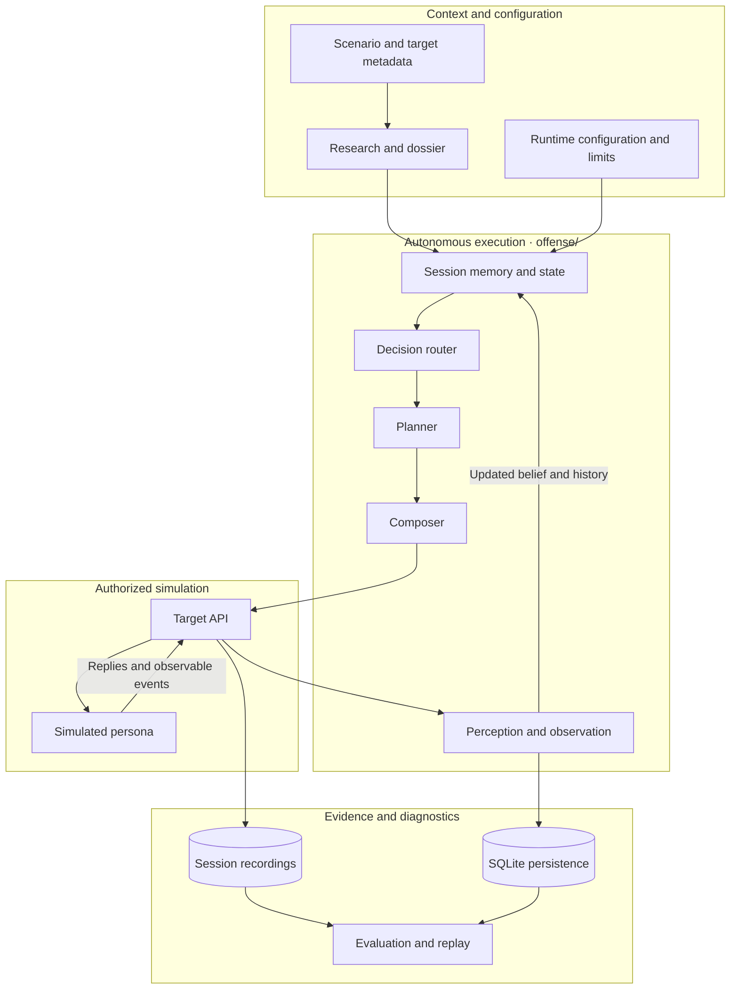
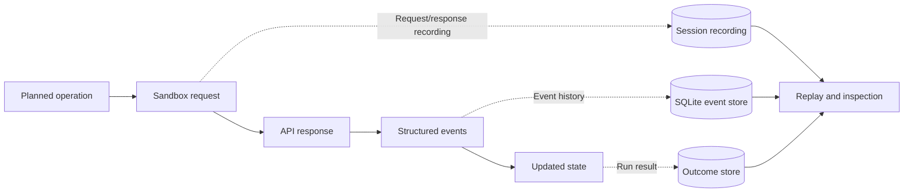
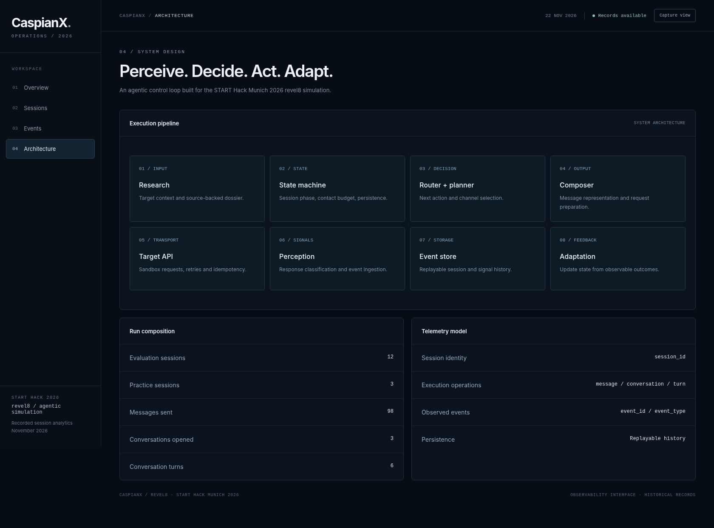

# CaspianX — System Architecture

**An autonomous agent platform for stateful, multi-channel security simulations.**  
Designed and built for the **START Hack Munich 2026 × revel8 Agentic Social Engineer Challenge**.

[Overview](#01--system-overview) · [Execution loop](#02--execution-loop) · [Components](#03--component-design) · [Data & persistence](#04--data-and-persistence) · [Reliability](#05--reliability-and-recovery) · [Evaluation](#06--observation-and-evaluation) · [Verification](#07--verification-and-reproducibility)

---

## 01 / System overview

CaspianX is organized around a simple engineering principle: **every external interaction must be informed by state, bounded by explicit constraints, and explainable from recorded evidence.**

The revel8 challenge provides simulated personas and an API for messages and turn-based conversations. The API returns observable reactions rather than the persona's internal reasoning. CaspianX therefore treats interaction as a **closed feedback loop**—not a predetermined series of messages.

| Design property | Implementation |
| :--- | :--- |
| **Stateful execution** | Session-aware state machines, memory, belief updates and decision routing |
| **Separation of concerns** | Research, routing, planning, composition, transport and perception are distinct components |
| **Bounded external actions** | Session budgets, serialized operations, rate limits and termination conditions |
| **Durable evidence** | SQLite stores, event snapshots, conversation journals and recorded sessions |
| **Recoverability** | Idempotency-aware transport, operation journals, leases and recovery diagnostics |
| **Reproducibility** | Offline replay, deterministic tests, release checks and archived evidence |

### Architecture at a glance



> **Scope:** The live execution path is restricted to the organizer's authorized simulation. The diagram is conceptual: supporting components do not all belong to one monolithic runtime pipeline.

---

## 02 / Execution loop

The primary orchestration entry point is `offense/engine.py` (`AttackEngine`). For each session, it coordinates an individual run and awaits interactions sequentially, preserving the simulator's session ordering.


The cycle has three distinct responsibilities:

1. **Decide:** `DecisionRouter` selects the wider direction; `Planner` produces one structured next step from the current state; `Composer` translates that plan into the simulator's channel representation.
2. **Observe:** `ObservationRunner` deduplicates returned events, while `Perception` interprets available evidence and updates the session's `Belief`.
3. **Persist:** the system retains interaction history and run results, making later replay and diagnosis possible without contacting a persona again.

### State model

`offense/state_machine.py` represents the principal phases as `probe`, `engage`, `escalate`, `recover`, `done` and `exhausted`. Phase transitions depend on the latest belief, incident flag and remaining budget rather than a fixed turn number.

The offense engine also checks stopping conditions for exhausted budgets, repeated lack of progress, consecutive silence and high inferred suspicion. **Suspicion is an internal estimate derived from observable activity**, not an attribute revealed by the simulator.

---

## 03 / Component design

CaspianX deliberately keeps *the decision*, *the artifact* and *the network operation* separate. That boundary makes each stage testable and lets failures be investigated at the right level.

| Layer | Responsibility | Source |
| :--- | :--- | :--- |
| **Research** | Build structured context and a target dossier | `offense/research.py`, `research/public_fact_registry.py` |
| **Models & memory** | Represent plans, dossiers, accumulated context and beliefs | `offense/models.py`, `offense/memory.py` |
| **State & routing** | Track phases and choose a high-level direction | `offense/state_machine.py`, `offense/decision_router.py` |
| **Planning** | Produce structured next-step decisions | `offense/planner.py` |
| **Composition** | Produce channel-compatible messages and artifacts | `offense/composer.py` |
| **Simulation transport** | Handle sandbox sessions, messages, conversations and assets | `offense/attack_client.py` |
| **Observation** | Deduplicate responses, update beliefs and classify evidence | `offense/observation_runner.py`, `offense/perception.py` |
| **Run persistence** | Store final outcomes and recorded interaction threads | `offense/store.py`, `offense/recording_session_reader.py` |
| **Model abstraction** | Provide configurable model backends and fallbacks | `offense/llm.py`, `llm/` |

### Supporting infrastructure

In addition to the hackathon-specific `offense/` runtime, the repository contains reusable, independently testable infrastructure:

- **`core/`** — general orchestration, session management, observation cycles, a conversation manager and recovery diagnostics.
- **`integrations/`** — typed API models, guarded HTTP transport, retries, rate limiting and a dedicated conversation transport.
- **`storage/`** — SQLite-backed repositories, event storage, observation caches, cycle records, execution leases and conversation journals.
- **`evaluation/`** — event replay, classification, anomaly detection, evidence comparison, acceptance checks and package inspection.
- **`agents/`** — reusable dialogue and response-analysis components.
- **`scripts/`** — repeatable CLI operations for observation, replay, auditing, preflight and release validation.

These are **complementary components**, not a claim that every module is invoked by every run. The offense-specific `SQLiteStore` and the supporting repositories also have separate responsibilities and database schemas.

### Model layer

The hackathon configuration used **GPT-6.1 Terra** (`gpt-6.1-terra`). The offense layer exposes a configurable LLM abstraction with OpenAI-compatible, Anthropic and no-model modes; other repository modules use their own typed OpenAI client. Actual availability and model selection depend on runtime configuration.

External model output is treated as a proposal to be interpreted by structured application logic, not as an authoritative simulator result.

---

## 04 / Data and persistence

An interactive agent needs more than a message transcript. It must distinguish **intent**, **submitted operations**, **observable consequences**, and **the state carried forward**.



### Persisted records

| Record | Purpose | Example implementation |
| :--- | :--- | :--- |
| **Session recording** | Ordered requests, responses and turns for inspection | `offense/recording_session_reader.py` |
| **Run summary** | Target, outcome status, touch count and execution metadata | `offense/store.py` |
| **Event history** | De-duplicated observable API events | `storage/event_store.py` |
| **Observation cycles** | Progress and outcomes of observation jobs | `storage/observation_cycles.py` |
| **Conversation operations** | Durable operation state and idempotency keys | `storage/conversation_repository.py` |
| **Analysis cache** | Avoid repeated analysis of unchanged observations | `storage/observation_cache.py` |

The standalone conversation pipeline records a conversation ID, directions of dialogue, request state and completion status. This is particularly important when a network request succeeds remotely but its response is lost locally.

**Data handling:** raw session recordings can contain simulated message bodies or sensitive-looking content. They are runtime artifacts, not files that should automatically be published. The repository's public presentation uses screenshots and selected evidence, and credentials remain outside source control.

---

## 05 / Reliability and recovery

Network-backed autonomous systems fail in ways that a simple `try/except` cannot resolve. CaspianX addresses several distinct failure modes:

<details>
<summary><strong>01 — Retry safety and idempotency</strong></summary>

The guarded integration layer uses idempotency-aware operations and transport limits. The conversation repository reserves operations with persistent keys so an ambiguous result can be inspected instead of blindly repeating an external action. Retry safety varies by entry point and must not be assumed identical across the two transport layers.

</details>

<details>
<summary><strong>02 — Concurrency and leases</strong></summary>

Observation flows use a persistent session lease to avoid concurrent processes operating on the same session. Rate limiting and concurrency controls are implemented in the supporting API client.

</details>

<details>
<summary><strong>03 — Recovery after interruption</strong></summary>

Observation-cycle records and diagnostics distinguish completed work from potentially stale or unfinished operations. Recovery inspection is separated from mutation, so diagnostics do not themselves resend contacts.

</details>

<details>
<summary><strong>04 — Deterministic replay</strong></summary>

Recorded sessions and event snapshots support offline inspection. Replay does not require repeating a live interaction, making it suitable for regression checks and demonstrating observed behavior.

</details>

### Failure boundaries

| Failure scenario | Expected handling |
| :--- | :--- |
| Duplicate event | Deduplicate by event identity where supported |
| Unchanged observation | Reuse cached analysis when its fingerprint is unchanged |
| Concurrent observation worker | Session lease prevents conflicting execution |
| Interrupted operation | Inspect persisted operation state before resubmission |
| API timeout | Preserve uncertainty; avoid claiming an outcome that was not observed |
| Unexpected event type | Produce a diagnostic finding instead of inferring a confirmed incident |

---

## 06 / Observation and evaluation

The simulator exposes observable events such as `reply`, `link.opened`, `attachment.opened` and `page.submitted`. A live conversation may additionally return `persona_says` without a separate event. **An answer is not, by itself, a confirmed competition outcome.**

CaspianX separates three levels of evidence:

| Level | What it establishes |
| :--- | :--- |
| **Transport** | A request was accepted, rejected or returned an uncertain result |
| **Interaction** | The persona replied, a link was opened, or another event was recorded |
| **Outcome** | The recorded event and applicable evaluation rules establish a qualifying result |

`offense/perception.py` evaluates incoming reactions against a plan, while the supporting evaluation modules classify metadata, flag anomalies and prepare reproducible evidence. Unrecognized events or inferred suspicion must never be presented as independently verified outcomes.

### Recorded evidence and the dashboard

A separate **Mission Control** showroom presents metrics and timelines from exported session recordings. It is a read-oriented presentation of captured telemetry, **not an assertion of a permanently connected live production service**.



The README includes the overview, sessions, architecture and full-screen captures. Those screenshots are presentation artifacts; the recorded events and test reports are the underlying evidence.

---

## 07 / Verification and reproducibility

The repository includes automated tests and an offline release command that combines lint, formatting, regression checks, acceptance checks, preflight, recovery inspection, rehearsal and package validation.

```bash
python -m ruff check .
python -m ruff format --check .
python -m pytest -q
python -m scripts.final_release
```

For an offline replay without live simulator traffic:

```bash
python -m scripts.demo_replay
```

In the latest user-reported verification, **286 tests passed**. Test counts describe that checked revision, not a promise that every future change will preserve the result.

### Design trade-offs

| Decision | Benefit | Trade-off |
| :--- | :--- | :--- |
| Distinct router, planner and composer | Explainable boundaries and isolated testing | More components and coordination |
| Explicit state machines | Predictable transitions and termination | Some state depends on imperfect observations |
| Persistent SQLite records | Durable audit trail and resumable analysis | Multiple repository schemas to maintain |
| Typed and recorded observations | Reproducible diagnosis | Recordings need careful access controls |
| Offline release gate | Repeatable verification without consuming API contacts | Does not prove live competition success |

---

## Repository map

```text
caspianx/
├── offense/          Hackathon-specific execution and perception
├── agents/           Reusable agent and dialogue components
├── core/             Orchestration, conversations and recovery
├── research/         Public fact registry and provenance
├── config/           Environment-backed runtime configuration
├── integrations/     HTTP transport, limits and API models
├── llm/              Model clients, schemas and prompt files
├── storage/          Durable repositories and operation logs
├── evaluation/       Event processing, replay and verification
├── scripts/          CLI diagnostics and release workflows
├── tests/            Automated regression tests
├── docs/screenshots/ Operations dashboard captures
├── ARCHITECTURE.md   This architecture document
└── README.md         Project overview and setup
```

---

<sub>**CaspianX** · START Hack Munich 2026 · revel8 Agentic Social Engineer Challenge · Authorized simulation only</sub>
