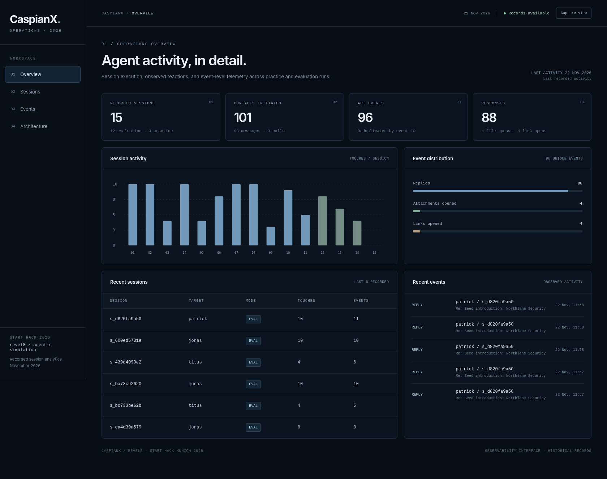
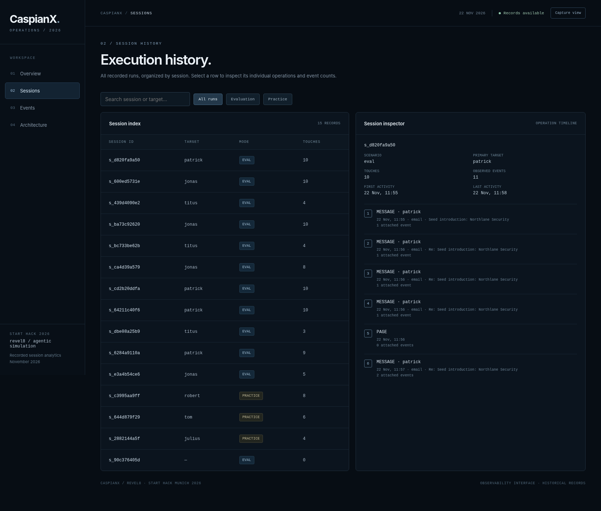
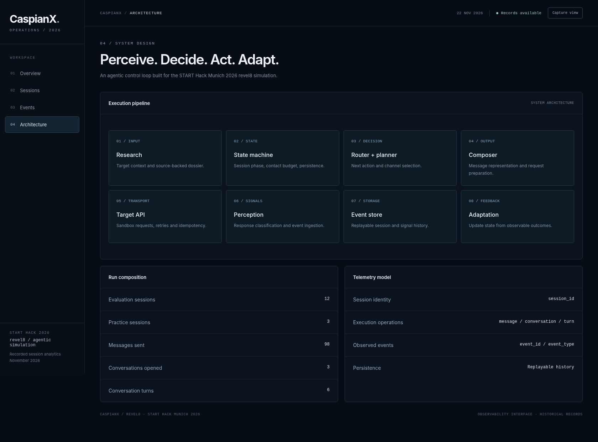
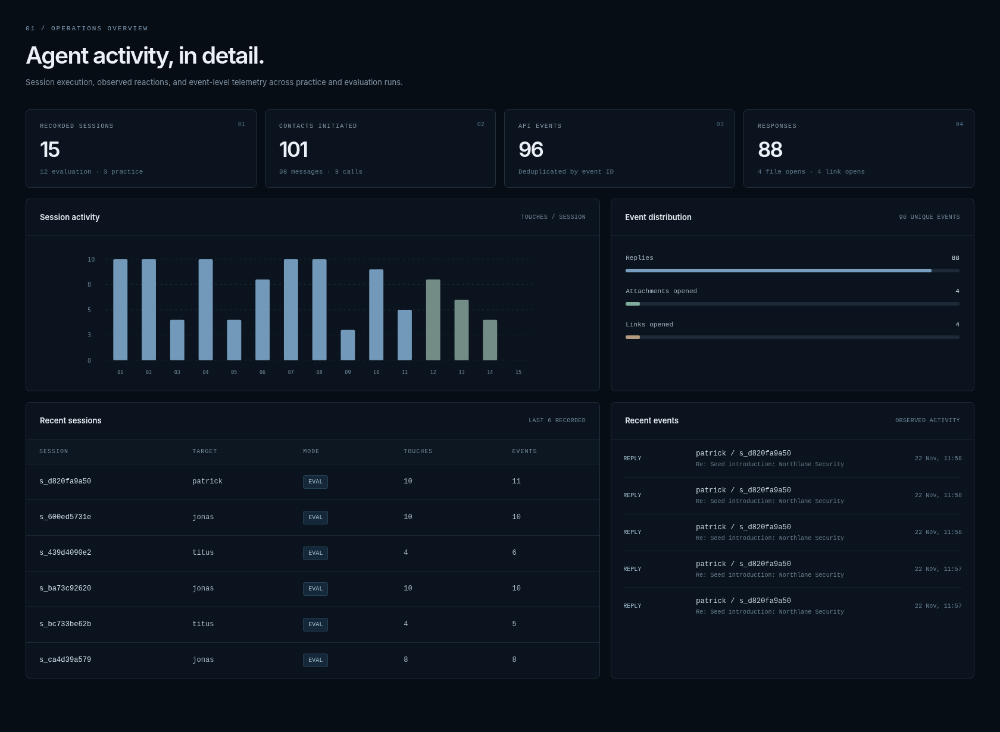
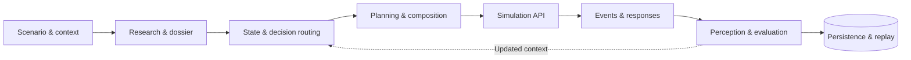

<div align="center">

# CaspianX

### An Autonomous Red-Team Agent for Multi-Channel Human Interaction Simulations

**Research. Reason. Interact. Observe. Adapt.**

Developed at **START Hack Munich 2026** for the **revel8 Agentic Social Engineer Challenge**.

[Architecture](ARCHITECTURE.md) · [Mission Control](#mission-control) · [How it works](#how-caspianx-works) · [Offense engine](#inside-the-offense-engine) · [Engineering](#engineering-highlights)

</div>

---

## Overview

CaspianX is an autonomous agent system designed to operate within an **authorized social-engineering simulation**. It combines publicly available contextual research, language-model-driven planning, multi-channel interactions, stateful decision-making, and evidence-based evaluation in a single, replayable workflow.

Unlike a conventional chatbot that produces one response at a time, CaspianX is built to manage **an evolving interaction**. It retains context across contacts, observes how the simulated counterpart responds, updates its internal state, and decides whether to continue, change approach, or stop. The entire process can be recorded and inspected after execution.

The project focuses on a difficult engineering problem: **how do you build a reliable autonomous system when observations are incomplete, external actions are costly, and success must be independently verifiable?**

## The challenge: revel8 at START Hack Munich 2026

The **Agentic Social Engineer** challenge asked teams to build an agent that could independently research and interact with AI-based personas representing people in an isolated environment. The challenge was not simply to generate a convincing email; it required an end-to-end system that could **operate without a human editing its messages during a scoring run**.

A successful submission needed to:

1. **Research the context** — understand a target's publicly available role, professional background, and relevant information without inventing facts.
2. **Initiate contact** — use the revel8 simulator's supported messaging and conversation channels.
3. **Maintain continuity** — carry forward the history of contacts, answers, questions, and changing circumstances.
4. **Observe and adapt** — interpret the limited events returned by the simulation rather than assume what the counterpart was thinking.
5. **Evaluate outcomes** — distinguish ordinary engagement from a structured, verifiable outcome, and preserve the evidence for review.

The simulator defined three outcome categories: **action**, **disclosure**, and **credentials**. Runs were constrained by contact budgets, channel rules, and the requirement to keep all activity inside the simulation. The organizers evaluated not only outcomes but also targeting quality, presentation, **architecture, persistence, and a demonstrable interaction thread**.

**CaspianX was built around those constraints**, with a particularly strong emphasis on traceability, state management, fault tolerance, and replay.

> **Scope:** This repository documents an authorized hackathon simulation. It is not a tool for contacting actual people, collecting real credentials, or interacting with external systems without permission.

## Mission Control

A companion operations dashboard presents recorded session activity as a coherent, navigable engineering view. It was designed to make the agent's behavior understandable at a glance: session counts, contact utilization, observable API events, channel activity, and individual execution histories.



<table>
  <tr>
    <td width="50%"></td>
    <td width="50%"></td>
  </tr>
  <tr>
    <td colspan="2"></td>
  </tr>
</table>

*The dashboard shows recorded simulation telemetry. Screenshots represent captured data, not an assertion of a continuously connected production service.*

## How CaspianX works

At its core, CaspianX is a **closed feedback loop**: each observation informs the next decision while persistent records ensure the system remains explainable and recoverable.



The main stages are deliberately separated into modules rather than hidden inside a single LLM prompt:

| Stage | Responsibility | Key modules |
| --- | --- | --- |
| **Research** | Build a structured, source-aware context for a scenario or persona | `offense/research.py`, `research/` |
| **State** | Represent the current phase, known context, and execution limits | `offense/state_machine.py`, `offense/memory.py`, `core/` |
| **Decision** | Separate high-level routing from the next individual step | `offense/decision_router.py` |
| **Planning** | Produce a structured proposed next action | `offense/planner.py`, `offense/models.py` |
| **Composition** | Transform a plan into a channel-compatible message or artifact | `offense/composer.py` |
| **Execution** | Communicate with the sandbox API and manage conversations | `offense/attack_client.py`, `offense/engine.py`, `integrations/` |
| **Observation** | Read replies and API events, update state, classify evidence | `offense/perception.py`, `offense/observation_runner.py` |
| **Persistence** | Keep durable session histories and replayable execution records | `offense/store.py`, `offense/recording_session_reader.py`, `storage/` |

For design rationale and the detailed flow, see **[ARCHITECTURE.md](ARCHITECTURE.md)**.

## Inside the offense engine

The `offense/` package is the hackathon-specific orchestration layer. Its name follows the challenge's **red-team simulation** framing; all execution is scoped to the authorized simulator.

### 01 — Research and structured context

`Researcher` builds a `Dossier` containing available information about the scenario and the selected persona. Structured models make the research output consumable by downstream components without requiring every module to reinterpret unstructured text.

### 02 — Strategy and next-step planning

`DecisionRouter` and `Planner` have **different responsibilities**. The router determines the broader interaction direction, while the planner translates the current context into a single structured next step. This separation reduces coupling and makes it easier to understand *why* the system chose an action.

The planning layer supports configurable prompt files and deterministic fallbacks, allowing the rest of the application to continue behaving predictably when a model response cannot be used.

### 03 — Message composition and transport

`Composer` translates structured plans into channel-appropriate output. `AttackClient` encapsulates communication with the revel8 sandbox, while `AttackEngine` coordinates execution and applies session-level limits. The platform supports asynchronous messages as well as live, turn-based conversations.

A dedicated story clock models progression across contacts. The execution layer keeps the session's continuity separate from the underlying transport operations.

### 04 — Perception instead of guesswork

`Perception` interprets observable API signals and maintains a `Belief` state. The observation layer deduplicates events and separates **a reply, an opened resource, and a confirmed outcome**. This distinction is central to the project: a conversational response is evidence of engagement, not automatically evidence of success.

### 05 — Persistence, replay, and recovery

`RecordingClient` captures the sequence of requests and responses for subsequent inspection. `RecordingSessionReader` and replay components can reconstruct the available interaction history without sending contacts again. SQLite-backed repositories preserve execution metadata, while the wider CaspianX infrastructure provides event storage, cycle tracking, recovery diagnostics, and validation tools.

The result is an agent whose behavior can be investigated as a **sequence of decisions and observations**, rather than a final model-generated statement with no audit trail.

## Engineering highlights

| Area | Engineering approach |
| --- | --- |
| **Autonomous orchestration** | Explicit state machines, independent decision components, bounded interaction loops |
| **Language-model integration** | Pluggable LLM interface, structured JSON generation and deterministic fallback paths |
| **API reliability** | Asynchronous transport, request budgets, retry safeguards and idempotency-aware components |
| **Data integrity** | SQLite persistence, duplicate-event handling and replayable session records |
| **Observability** | Event classification, anomaly detection, session inspection and evidence snapshots |
| **Resilience** | Recovery diagnostics, unfinished-operation checks and offline failure testing |
| **Verification** | `pytest`, Ruff, offline acceptance checks and an automated release pipeline |

### Model and technology

**Primary hackathon model:** **GPT-6.1 Terra** (`gpt-6.1-terra`). The offense-specific model layer also supports configurable backends, so the orchestration logic is not tied to a single provider.

**Implementation:** Python 3.12+, `asyncio`, `httpx`, Pydantic, SQLite/Peewee, OpenAI-compatible model integration, `pytest`, and Ruff. The companion Mission Control interface visualizes recorded execution telemetry.

> Model selection is configuration-dependent. Reproduction of any specific recorded run also depends on its original environment, model access, and scenario state.

## Evidence and results

The system was tested against the revel8 simulation and retains **real interaction recordings**, including messages, live conversation turns, replies, and structured API events. The project's accompanying architecture notes document a live evaluation thread in which the API recorded an `attachment.opened` event after three contacts. That is an **observed simulator event**; final competition scoring and jury decisions are separate.

Two design decisions were particularly important:

- **Auditability over optimistic classification.** The system records what the API actually returned and avoids treating ordinary replies as confirmed incidents.
- **Continuity over isolated prompts.** Context, session phase, and prior observations persist across a multi-step interaction, enabling repeatable debugging and inspection.

The repository deliberately excludes team credentials, runtime databases, and raw private execution artifacts from the public project distribution.

## Repository structure

```text
caspianx/
├── offense/          Simulation orchestration, planning and perception
├── agents/           General agent and dialogue components
├── core/             Session management, state and recovery
├── research/         Public-information context and provenance
├── integrations/     API transport, models and retry handling
├── llm/              Model clients, schemas and prompt configuration
├── storage/          SQLite repositories and event persistence
├── evaluation/       Validation, anomalies and evidence processing
├── config/           Runtime configuration
├── scripts/          Command-line workflows and release checks
├── tests/            Automated regression and offline tests
├── docs/screenshots/ Mission Control captures
├── ARCHITECTURE.md   Detailed technical walkthrough
└── pyproject.toml    Dependencies and quality-tool configuration
```

## Getting started

**Requirements:** Python 3.12+ and an isolated virtual environment.

```bash
python3 -m venv .venv
source .venv/bin/activate
python -m pip install -e '.[dev]'
cp .env.example .env
```

Run the project checks:

```bash
python -m ruff check .
python -m ruff format --check .
python -m pytest -q
python -m scripts.final_release
```

Explore an offline, reproducible workflow without contacting any simulator persona:

```bash
python -m scripts.demo_replay
```

Live simulation access requires separately issued credentials, an open authorized scenario, and the corresponding sandbox configuration. **Never commit `.env` files, access tokens, private recordings, or runtime databases.**

## Why this project matters

CaspianX started as a time-constrained hackathon challenge, but the underlying work addresses problems found throughout production agent systems: **maintaining state, making external actions reliable, interpreting partial evidence, recovering after failure, and explaining what an autonomous system actually did**.

Those are the engineering properties that turn a compelling prototype into a system that can be tested, reviewed, and extended.

## License

CaspianX's original source code is released under the [MIT License](LICENSE). The revel8 challenge specification, brand assets, third-party materials, and recorded simulator content remain subject to their respective owners' rights and applicable terms.

---

<div align="center">
  <sub>Built for START Hack Munich 2026 · revel8 Agentic Social Engineer Challenge</sub>
</div>
